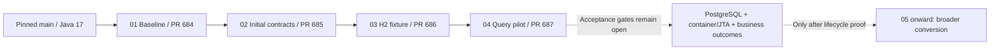

# Migration implementation status

The first four implementation branches are separate stacked drafts from the
pinned Java 17 main baseline. Each PR shows only its own increment. Parent fixes
are merged forward within the stack without rewriting history. No PR has been
merged to main; no deployment, schema migration or message recovery was performed.

| Step | Draft PR | Prepared work | Still required for the full roadmap gate |
|---|---|---|---|
| 01 | [684](https://github.com/hmcts/cpp-context-progression/pull/684) | Bounded collector, qualified command-RAML refresh and optional-cache opt-out | Effective dependency/runtime manifest, test reconciliation and relevant journeys |
| 02 | [685](https://github.com/hmcts/cpp-context-progression/pull/685) | Seven initial repository characterization tests | Remaining lifecycle, event, Material/Listing and MI contract population |
| 03 | [686](https://github.com/hmcts/cpp-context-progression/pull/686) | Isolated javax JPA/H2 fixture with commit, flushed rollback and isolation tests | Same outcome comparison, PostgreSQL and container/JTA coverage |
| 04 | [687](https://github.com/hmcts/cpp-context-progression/pull/687) | One explicit JPQL finder while retaining DeltaSpike CRUD/context/transaction strategy | Full reactor/CDI/query parity; actual framework lifecycle, identity, flush, rollback and concurrency proof before replacement |

The Step 04 branch name retains the roadmap identity. Its current implementation
is only a partial query pilot. It does not remove DeltaSpike or complete explicit
lifecycle ownership. The original scope and acceptance criteria in
work-packages.json remain unchanged.

## Existing CI route

| PR | Verification run | Final result |
|---|---|---|
| 684 | [950055](https://dev.azure.com/hmcts-cpp/cpp-apps/_build/results?buildId=950055) | Success; Sonar and secret scanning successful |
| 685 | [950054](https://dev.azure.com/hmcts-cpp/cpp-apps/_build/results?buildId=950054) | Success; Sonar and secret scanning successful |
| 686 | [950051](https://dev.azure.com/hmcts-cpp/cpp-apps/_build/results?buildId=950051) | Success; Sonar and secret scanning successful |
| 687 | [950053](https://dev.azure.com/hmcts-cpp/cpp-apps/_build/results?buildId=950053) | Success; Sonar and secret scanning successful |

All four current draft revisions passed the existing PR verification pipeline.
This establishes that execution result, not completion of the full roadmap gates.
The template runs Maven verify and Sonar. Its persistence-test flag must be interpreted using actual
resolved artifacts and execution reports; neither the flag's name nor a green
overall status proves the new CDI tests ran. The shared template reference,
Maven/Sonar checks, test selection and runtime settings are unchanged. Step 01
changes two POM entries for the qualified command RAML refresh and passes the
supported optional-cache opt-out to the PR verification template.

The first baseline Maven attempt in run 949881 failed interface enforcement:
listing-command-api 17.104.10 was behind released 17.104.16. The used Listing
command schemas/examples and root RAML/media mappings are byte-identical between
those releases. Three other schemas add only an optional MANUAL/AUTO field.
Step 01 now sets listing.command.api.version to 17.104.16 solely for the existing
command RAML generator dependency, retaining transitive exclusions. Listing query
dependencies remain at 17.104.10. The normal enforcer remains enabled. The fix is
carried forward through the stack, and the table links fresh verification runs.
Superseded runs are not treated as passing results.

The next verification cycle exposed separate CI failures:

- Run 949979 passed Maven and Sonar, then failed the post-job Maven cache archive:
  tar wrote 4096 of 10240 bytes and exited 2. The underlying storage cause is
  unverified. Step 01 now sets enableMavenCache=false for this repository's PR
  route. The new run has no cache restore/archive tasks; normal verification and
  analysis remain. IndividualCI validation/deployment is unchanged.
- Run 949975 passed Maven (23m14s), then failed Sonar compute-engine processing.
  Scanner and reporter both identify task
  8e5347a4-397d-4099-8db7-3a5f2d6ee1d2. This is not a failed-test or identified
  quality-metric diagnosis. Detailed server errorMessage remains unavailable:
  browser and system curl reject the private CA chain. Certificate verification
  was retained. A later pass cannot erase this unresolved first failure.

The existing shared reporting correlation fix [PR 530](https://github.com/hmcts/cpp-azure-devops-templates/pull/530)
is open and blocked, with CI 948393 successful. It is not merged or consumed by
these runs. Current c0a93fde selects a shared project queue/current task; require
scanner ceTaskId and analysisId correlation before release. The task IDs did
match for the particular 949975 failure, so the shared selection risk is not its
established cause.

Baseline run 949881 reports Maven 3.9.5 and Eclipse Adoptium Java 17.0.15.
OpenEJB/CDI repository tests were observed executing. The resolved template is
c0a93fdebdd2a2f79ab88e57f5d20ded0a74eeae and the baseline PR merge revision is
db4bc113cdb86794b2c3b088eccd421ace059713. These observations establish that
execution started; they do not establish a passing run or complete coverage.
Its test logs also identify DeltaSpike JPA/OpenEJB components at 1.9.6; this is
test-classpath evidence, not a deployed WildFly dependency manifest.

Before the finder change, run 949975 at merge revision
24461d7045d07f8856cea1a493dde9cf1e1ef126 reports the following affected suites.
After the finder change, run 949978 at merge revision
81a3164a13292cbcd495cbf2cff8ab28e98bea7b reports the same counts and zero
failures/errors/skips. These precede the cache-only CI edit and are not final
pipeline-result claims.

Final pilot run 950053 at merge revision
bf996eecbf60e05f2b49df03bf08020a1bfe0fbb re-executed these same suites and counts,
again with zero failures, errors or skips. Its full pipeline succeeded. It used
Eclipse Adoptium Java 17.0.15, Maven 3.9.5 and template c0a93fde. The baseline and
characterization merge revisions were respectively
df029ee2adaf633d2e6f465eebb69ddff6614c98 and
bcc510b4a529a1af6740b7f5895ad4d2202f51b4.

| Suite | Executed | Failures | Errors | Skipped |
|---|---:|---:|---:|---:|
| MatchDefendantCaseHearingRepositoryTest | 9 | 0 | 0 | 0 |
| RelatedReferenceRepositoryContractTest | 6 | 0 | 0 | 0 |
| RelatedReferenceJpaTestContextTest | 3 | 0 | 0 | 0 |

These 18 cases include the ten new tests. They prove the initial assertions ran
on the pilot classpath, including CDI query construction; they do not establish
PostgreSQL/WildFly parity, the broader business/contract population or completion
of Step 04.

The pilot retains inherited DeltaSpike CRUD and manager lookup. Its concrete
finder bypasses the derived-query handler's restrictions/processors and exception
path; their parity is not established by retaining the base class. DeltaSpike
1.9.6 source shows no old explicit pre-query flush or transaction-strategy joining
for the plain unannotated finder. Framework release-17.104.0 at
e94e5b834b8a0f961f0768c9d0d39d5c7d3e8a45 supplies a separate conditional
post-listener flush in finally. The artifact is retained. Actual resolved-version,
pending-write visibility, manager/JTA joining, provider flush and error-path
qualification remain open; no lifecycle equivalence is inferred from this source
review or the green H2-based pipeline.

Source references: [DeltaSpike partial proxy](https://github.com/apache/deltaspike/blob/deltaspike-1.9.6/deltaspike/modules/partial-bean/impl/src/main/java/org/apache/deltaspike/partialbean/impl/PartialBeanProxyFactory.java),
[transaction runner](https://github.com/apache/deltaspike/blob/deltaspike-1.9.6/deltaspike/modules/data/impl/src/main/java/org/apache/deltaspike/data/impl/tx/TransactionalQueryRunner.java),
and [released framework flush hook](https://github.com/hmcts/cp-microservice-framework/blob/e94e5b834b8a0f961f0768c9d0d39d5c7d3e8a45/persistence/persistence-deltaspike/src/main/java/uk/gov/justice/services/persistence/EntityManagerFlushInterceptor.java).

Local verification: four collector parser tests passed; source/API review and
diff whitespace checks passed. Local Java application compilation/tests were not
run because approved private artifact settings are unavailable.

## Human work to close the gates

[What the missing test support means, and how to add it](test-support-next-steps.md).

- Build owner: retain the actual JDK/Maven, merge SHA, template SHA and resolved
  dependency manifest; provide the authorized CI report/effective-POM route.
  Inspect the exact failed Sonar task through an approved trusted route and
  qualify analysis-specific reporting; do not infer its detailed cause from the
  generic failed status or weaken certificate verification.
- Test and contract owners: reconcile executed/skipped tests and supply the
  remaining representative business/event/MI assertions and fixtures.
- Build/test/platform developers: add isolated PostgreSQL and current-runtime
  container/JTA test support. No ready-made gate or prepared environment is
  established. Select a qualified current runtime image/provider, create isolated
  stores/fixtures, add commit/rollback/context/flush assertions and wire a separate
  CI test job before accepting Steps 03/04.
- Framework and persistence reviewers: qualify the consumed EntityManager
  producer, flush/transaction policy and context identity before replacing them.

The existing [tests-only validation template](https://github.com/hmcts/cpp-azure-devops-templates/blob/c0a93fdebdd2a2f79ab88e57f5d20ded0a74eeae/pipelines/context-validation-tests.yaml)
is a possible environment route, but requires an existing matching ephemeral
agent/workspace, preserved namespace/routes and `shouldrun=true`. Its source-SHA
parameter is logged rather than checked out by the test step; verify actual HEAD
and the deployed image/configuration. Integration fixtures can clean stores and
recreate indexes, so a prepared namespace must also have isolated storage,
messaging/search and reviewed synthetic-data cleanup scope. No such job was
triggered in this work. Full validation and runIntegrationTests.sh also deploy or
migrate and are outside the current verification runs.

These are acceptance prerequisites. No broad conversion or release should use
the partial H2/query pilot as evidence that those prerequisites have been met.

## Parallel Java 25 prerequisite branch

[Draft PR 690](https://github.com/hmcts/cpp-context-progression/pull/690) implements
Step 10 on Step 01, separately from the Java 17 persistence stack. It adds an
isolated Java 25 CI probe; application source/parent and deployment routes remain
unchanged. CI 950134 executed on Java 25.0.2/Maven 3.9.16: three Java tests, two
passed and one failed because the selected chain resolves Hibernate 6.6.1.Final
rather than 7. Both MI test classifiers also failed legacy Java EE inspection;
RELEASE remains an unqualified moving selector. This is failed readiness evidence.

The follow-up hardening revision requires clean outputs and rejects newer/preview
classfiles. CI 950145 re-executed six inspector tests successfully and reproduced
the same provider/MI failures on Java 25.0.2/Maven 3.9.16. The separate Java 17
RunVerification job is queued awaiting agent acknowledgement; its parent-stage
running status is not execution or a final pass. Exact evidence and new
main drift are tracked in [Java 25 evidence and next steps](java25-readiness.md).
No whole-application Java 25 build or runtime acceptance has occurred. Steps 05–09
retain Java 17; 11–14 remain gated proposed branches. Original acceptance criteria
are unchanged.
