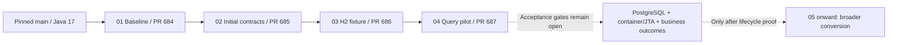

# Initial implementation status

The first four implementation branches are separate stacked drafts from the
pinned Java 17 main baseline. Each PR shows only its own increment. No merge,
deployment, schema migration or message recovery has been performed.

| Step | Draft PR | Prepared work | Still required for the full roadmap gate |
|---|---|---|---|
| 01 | [684](https://github.com/hmcts/cpp-context-progression/pull/684) | Bounded baseline collector and existing PR verification entry point | Executed baseline, effective dependency/runtime manifest, test reconciliation and relevant journeys |
| 02 | [685](https://github.com/hmcts/cpp-context-progression/pull/685) | Seven initial repository characterization tests | Actual execution; remaining lifecycle, event, Material/Listing and MI contract population |
| 03 | [686](https://github.com/hmcts/cpp-context-progression/pull/686) | Isolated javax JPA/H2 fixture with commit, flushed rollback and isolation tests | Resolved-classpath execution, same outcome comparison, PostgreSQL and container/JTA coverage |
| 04 | [687](https://github.com/hmcts/cpp-context-progression/pull/687) | One explicit JPQL finder while retaining DeltaSpike CRUD/context/transaction strategy | Full reactor/CDI/query parity; actual framework lifecycle, identity, flush, rollback and concurrency proof before replacement |

The Step 04 branch name retains the roadmap identity. Its current implementation
is only a partial query pilot. It does not remove DeltaSpike or complete explicit
lifecycle ownership. The original scope and acceptance criteria in
work-packages.json remain unchanged.

## Existing CI route

| PR | Verification run |
|---|---|
| 684 | [949881](https://dev.azure.com/hmcts-cpp/cpp-apps/_build/results?buildId=949881) |
| 685 | [949911](https://dev.azure.com/hmcts-cpp/cpp-apps/_build/results?buildId=949911) |
| 686 | [949913](https://dev.azure.com/hmcts-cpp/cpp-apps/_build/results?buildId=949913) |
| 687 | [949915](https://dev.azure.com/hmcts-cpp/cpp-apps/_build/results?buildId=949915) |

These are run references, not passing results. The existing template runs Maven
verify and Sonar. Its persistence-test flag must be interpreted using actual
resolved artifacts and execution reports; neither the flag's name nor a green
overall status proves the new CDI tests ran. No template, POM, test selection or
runtime setting was changed for this work.

Baseline run 949881 reports Maven 3.9.5 and Eclipse Adoptium Java 17.0.15.
OpenEJB/CDI repository tests were observed executing. The resolved template is
c0a93fdebdd2a2f79ab88e57f5d20ded0a74eeae and the baseline PR merge revision is
db4bc113cdb86794b2c3b088eccd421ace059713. These observations establish that
execution started; they do not establish a passing run or complete coverage.
Its test logs also identify DeltaSpike JPA/OpenEJB components at 1.9.6; this is
test-classpath evidence, not a deployed WildFly dependency manifest.

Pilot run 949915, merge revision
2c2ce6b446873096e402b9e547b31a101eb4a39c, reports these affected suites:

| Suite | Executed | Failures | Errors | Skipped |
|---|---:|---:|---:|---:|
| MatchDefendantCaseHearingRepositoryTest | 9 | 0 | 0 | 0 |
| RelatedReferenceRepositoryContractTest | 6 | 0 | 0 | 0 |
| RelatedReferenceJpaTestContextTest | 3 | 0 | 0 | 0 |

These 18 cases include the ten new tests. They prove the initial assertions ran
on the pilot classpath, including CDI query construction; they do not establish
a passing full pipeline, PostgreSQL/WildFly parity or completion of Step 04.

Local verification: four collector parser tests passed; source/API review and
diff whitespace checks passed. Local Java application compilation/tests were not
run because approved private artifact settings are unavailable.

## Human work to close the gates

- Build owner: retain the actual JDK/Maven, merge SHA, template SHA and resolved
  dependency manifest; provide the authorized CI report/effective-POM route.
- Test and contract owners: reconcile executed/skipped tests and supply the
  remaining representative business/event/MI assertions and fixtures.
- Platform and database owners: provide an approved isolated PostgreSQL and
  current-runtime container/JTA test route without deploying to a shared service.
- Framework and persistence reviewers: qualify the consumed EntityManager
  producer, flush/transaction policy and context identity before replacing them.

The existing [tests-only validation template](https://github.com/hmcts/cpp-azure-devops-templates/blob/c0a93fdebdd2a2f79ab88e57f5d20ded0a74eeae/pipelines/context-validation-tests.yaml)
is a possible environment route, but requires an existing matching ephemeral
agent/workspace, preserved namespace/routes and `shouldrun=true`. Its source-SHA
parameter is logged rather than checked out by the test step; verify actual HEAD
and the deployed image/configuration. Integration fixtures can clean stores and
recreate indexes, so a prepared namespace must also have isolated storage,
messaging/search and reviewed synthetic-data cleanup scope. No such job was
triggered in this work. Full validation and runIntegrationTests.sh also deploy or
migrate and are outside the current verification runs.

These are acceptance prerequisites. No broad conversion or release should use
the partial H2/query pilot as evidence that those prerequisites have been met.
