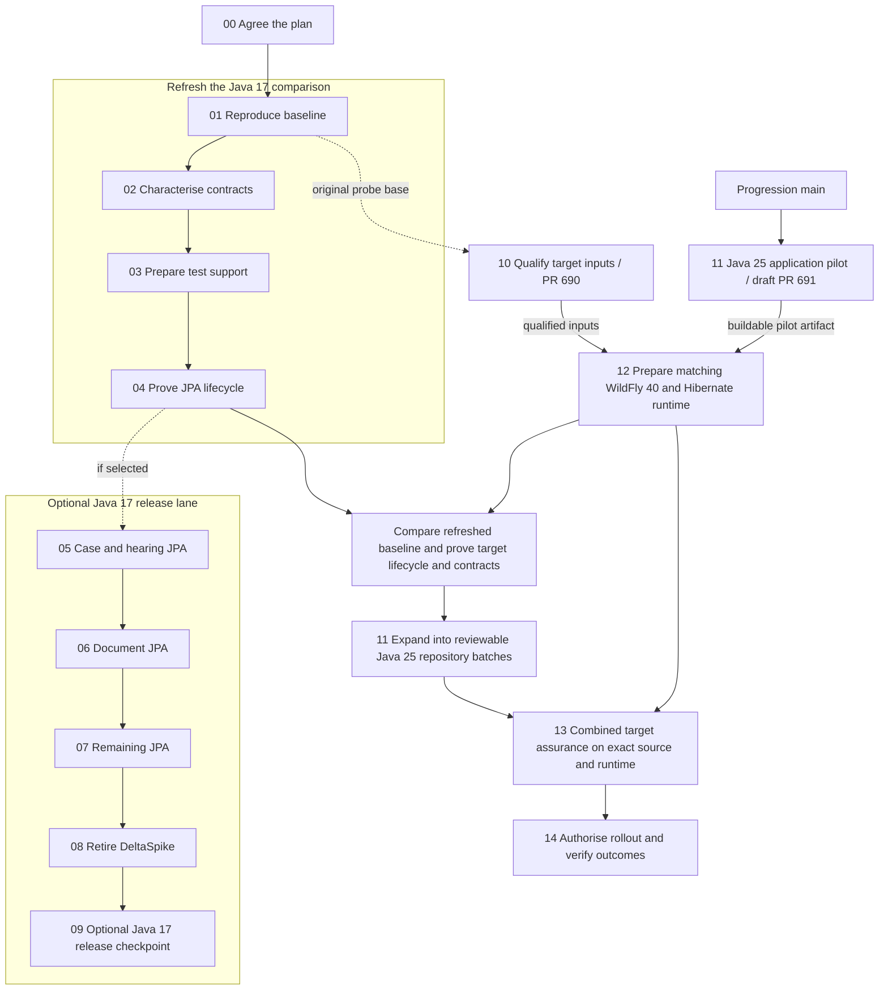

# Visual migration roadmap

The Java 25 application pilot starts from current `main` while the platform owners resolve Step 10. Steps 01–04 supply the refreshed Java 17 comparison. Steps 05–09 are an optional intermediate release. Arrows show dependencies and acceptance gates without calendar dates.

[Open the SVG roadmap](roadmap.svg)

Step 11 can begin while the baseline refresh and Step 10 are in progress. Before broader conversion, qualify the selected target dependencies and prove representative PostgreSQL and WildFly/JTA lifecycle and contract outcomes with a buildable pilot. Convert case/hearing, document and remaining repository groups on Java 25 by default. If the optional Java 17 route is selected, carry accepted changes into the target without converting the same methods twice.

The first Step 11 slice passed locally on upstream WildFly 40 and PostgreSQL.
[Draft PR 691](https://github.com/hmcts/cpp-context-progression/pull/691) ·
[Executed evidence and open gates](java25-readiness.md#step-11-first-application-slice)

Step 12 prepares after qualified Step 10 and completes with a buildable Step 11 artifact. Step 13 can stack tests on Step 11 while it is unmerged. Accept the final combined source, image, configuration, executed MI and other contracts, measured performance and rollback evidence before integration and release. [Branch register](branch-register.csv) · [Target evidence and open gates](java25-readiness.md)
