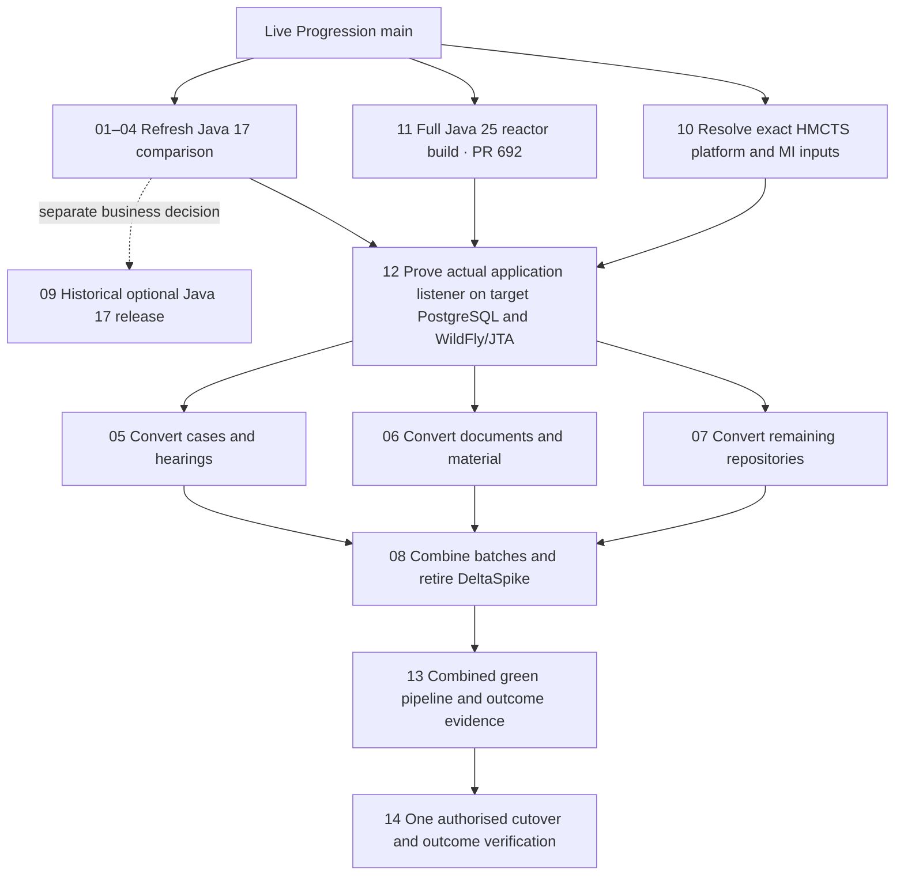

# Visual migration roadmap

Start the full Java 25 reactor from live `main`. Refresh the Java 17 comparison and qualify the real HMCTS platform and MI inputs in parallel. Prove the actual application listener on PostgreSQL and the matched WildFly/JTA runtime before the wider repository conversion.

[Open the SVG roadmap](roadmap.svg)

The Step 11 branch is `migration/progression-11-java25-full-build`, based on live `main` at `f3dbf8c897e74302e5b3c54d22e4cd315c6b21de`. The first full-reactor verification started on the Java 25 agent. [Draft PR 692](https://github.com/hmcts/cpp-context-progression/pull/692) · [Initial CI 955262](https://dev.azure.com/hmcts-cpp/cpp-apps/_build/results?buildId=955262) · [Rerun 955268](https://dev.azure.com/hmcts-cpp/cpp-apps/_build/results?buildId=955268)

The earlier upstream repository slice and platform probe inform qualification. [Draft PR 691](https://github.com/hmcts/cpp-context-progression/pull/691) · [Draft PR 690](https://github.com/hmcts/cpp-context-progression/pull/690) · [Recorded evidence](java25-readiness.md)

Steps 05–07 are sibling Java 25 changes on the common qualified build. Step 08 combines the batches and checks complete caller and dependency coverage. Step 13 uses the final source SHA, image digest and configuration to reconcile executed MI and other contracts, current-main parity, performance and rollback. The Step 14 release owner authorises one coordinated source and runtime cutover. [Branch register](branch-register.csv)
