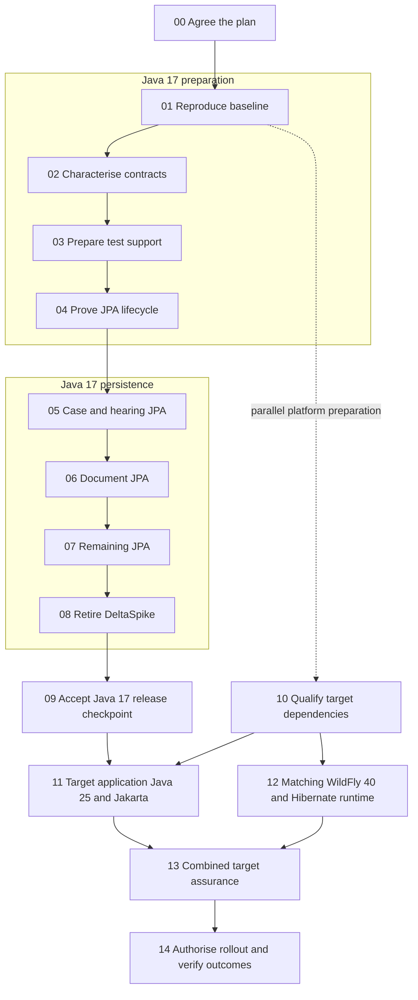

# Visual migration roadmap

This is an evidence-gated sequence, not a calendar schedule. Every numbered step maps to a separate branch in the register.

[Full visual roadmap](roadmap.svg)

Steps 01 to 09 preserve Java 17 and the existing enterprise APIs, Hibernate provider and runtime. Step 10 can progress in parallel. Steps 11 and 12 are separately reviewed source/configuration changes but require coordinated target validation; no unsupported intermediate production stack is assumed. Step 13 is a stacked test/evidence branch on Step 11 until parent changes merge.
